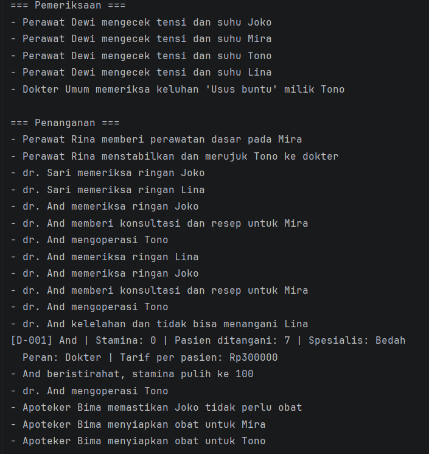
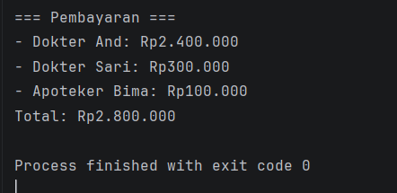

# Sistem Rumah Sakit

Responsi Akhir Praktikum Pemrograman Berorientasi Objek
Jurusan Informatika, Fakultas Teknik, Universitas Jenderal Soedirman

## Identitas

| Keterangan | Isi                                      |
|-----------|------------------------------------------|
| Nama      | _Rafa Al Ghazirah_                       |
| NIM       | _H1D025047_                              |
| Tema      | Rumah Sakit (digit terakhir NIM 6 dan 7) |

## Deskripsi

Simulasi satu hari kerja rumah sakit. Dokter, Perawat, dan Apoteker menangani
antrean pasien sesuai tingkat keparahan. Setiap penanganan mengurangi stamina dan
mengubah status pasien. Stamina yang habis membuat tenaga medis harus istirahat,
dan biaya layanan dihitung dari jumlah pasien yang ditangani.

## Struktur Project

```
rs-oop/
├── src/
│   ├── Diperiksa.java
│   ├── Ditagih.java
│   ├── Pasien.java
│   ├── TenagaMedis.java
│   ├── Dokter.java
│   ├── Perawat.java
│   ├── Apoteker.java
│   └── Main.java
├── .gitignore
└── README.md
```

## Hubungan Antar Class

| Class | Jenis | Keterangan |
|-------|-------|------------|
| `TenagaMedis` | abstract class | Superclass dengan abstract method `tangani(Pasien)` |
| `Dokter` | subclass | `extends TenagaMedis implements Diperiksa, Ditagih` |
| `Perawat` | subclass | `extends TenagaMedis implements Diperiksa` |
| `Apoteker` | subclass | `extends TenagaMedis implements Ditagih` |
| `Diperiksa` | interface | Method `periksa(Pasien)` |
| `Ditagih` | interface | Method `hitungBiaya()` |
| `Pasien` | class | Data pasien beserta status penanganan |
| `Main` | class | Simulasi dan pengujian seluruh persyaratan |

## Pemetaan Persyaratan

| No | Konsep | Implementasi |
|----|--------|--------------|
| 1 | State dan Behavior | Atribut di `TenagaMedis`; `istirahat()` (void); `getInfo()` (return) |
| 2 | Immutability | `NAMA_RS`, `STAMINA_MAKSIMAL` (`public static final`); `idPegawai` dan `noRekamMedis` (`private final`) |
| 3 | Enkapsulasi dan Overloading | Atribut private, getter/setter, `this`, dua konstruktor per class |
| 4 | Inheritance | `Dokter`, `Perawat`, `Apoteker` `extends TenagaMedis`; `Main` terpisah |
| 5 | Super Chaining | `super(...)` pada konstruktor; `super.getInfo()`, `super.tampilkanInfo()` |
| 6 | Method Overriding | `getInfo()`, `tampilkanInfo()`, `tangani()`, `periksa()`, `hitungBiaya()` dengan `@Override` |
| 7 | Abstract Class | `TenagaMedis` dengan abstract method `tangani(Pasien)` |
| 8 | Logika State Percabangan | `tangani()` memakai if/else pada `stamina`, lalu mengubah `stamina`, `jumlahPasien`, dan status pasien |
| 9 | Polimorfisme Interface | `Diperiksa pemeriksaAwal = new Perawat(...)`, parameter `Ditagih` pada `cetakTagihan()` |
| 10 | Multiple Interface | `Dokter implements Diperiksa, Ditagih` |

## Pembuktian di Luaran Program

| Bagian Luaran | Persyaratan yang Terbukti |
|---------------|---------------------------|
| Baris pembuka dengan nama rumah sakit | Konstanta global (2) |
| Pemeriksaan oleh perawat dan dokter | Polimorfisme interface (9) |
| Tindakan berbeda sesuai keparahan pasien | Abstract method dan logika if/else pada state (7, 8) |
| Dokter kelelahan, lalu info dokter ditampilkan | Overriding dan `super.getInfo()` (5, 6), `idPegawai` final (2) |
| Dokter istirahat dan stamina pulih | Perubahan state lewat setter (3, 8) |
| Tagihan dokter dan apoteker | Multiple interface (10), polimorfisme (9) |
| Pembuatan objek dengan konstruktor berbeda | Overloading (3), `super(...)` (5), inheritance (4) |

## Output Program
1. 

2.
